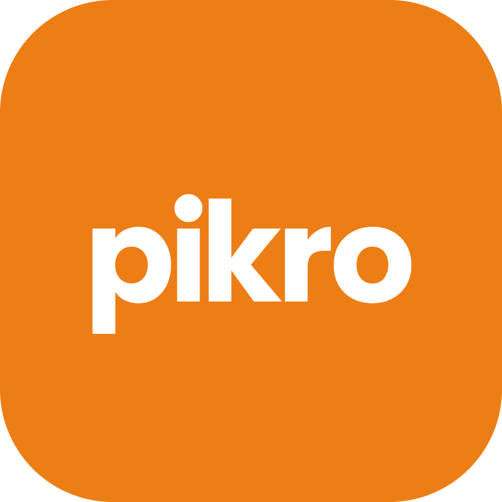
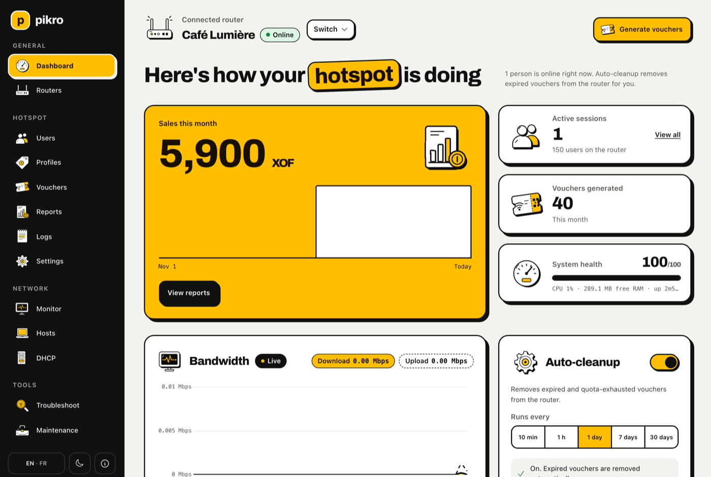
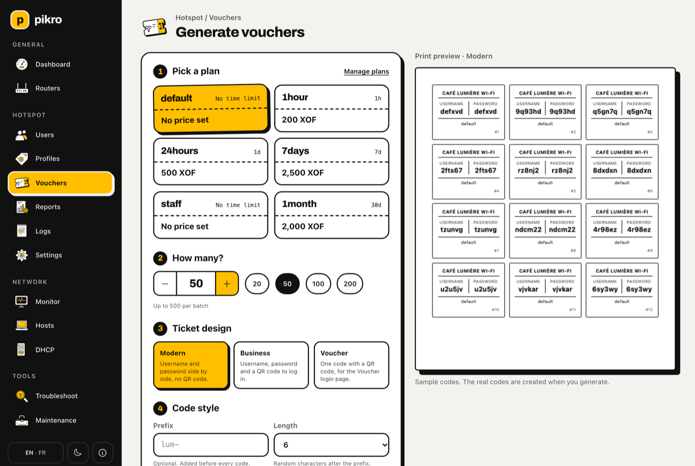
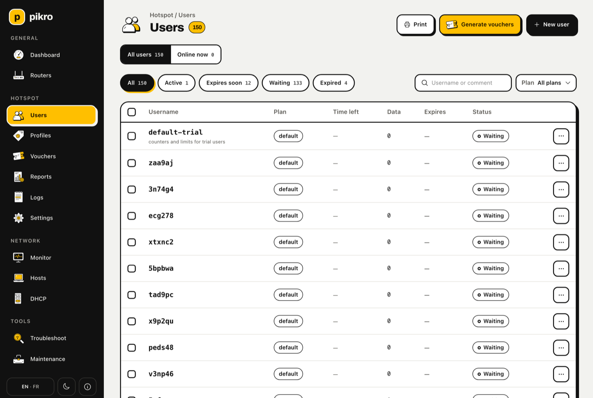
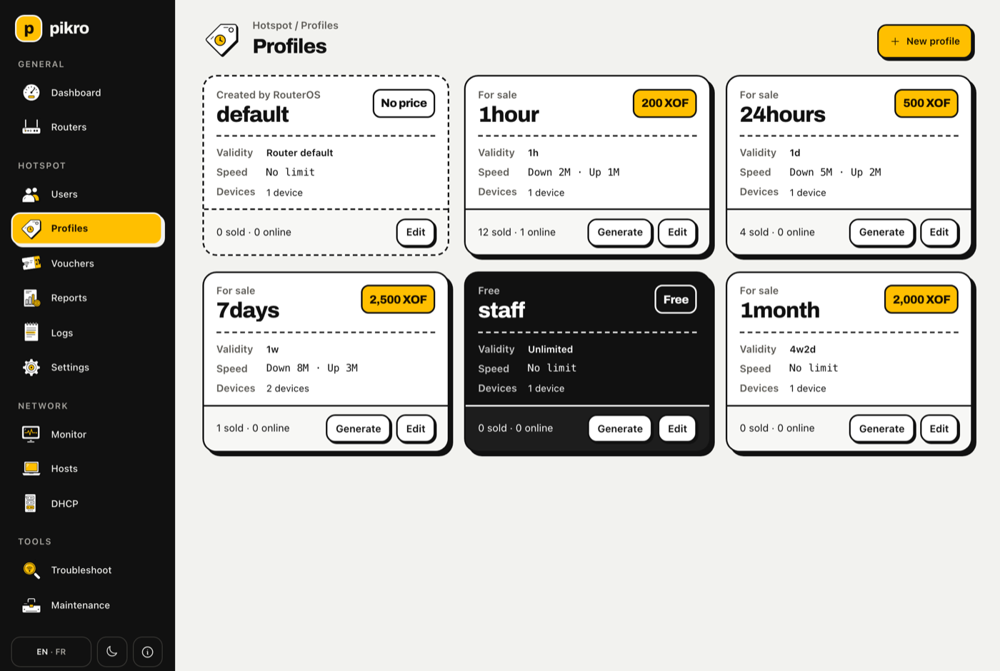
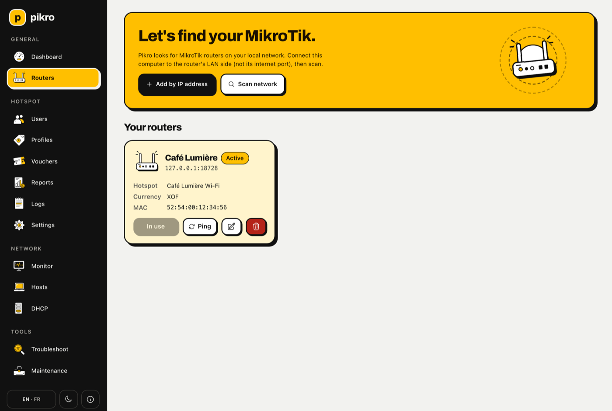
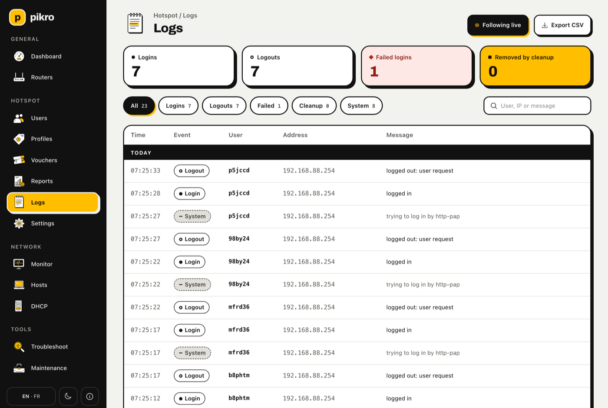
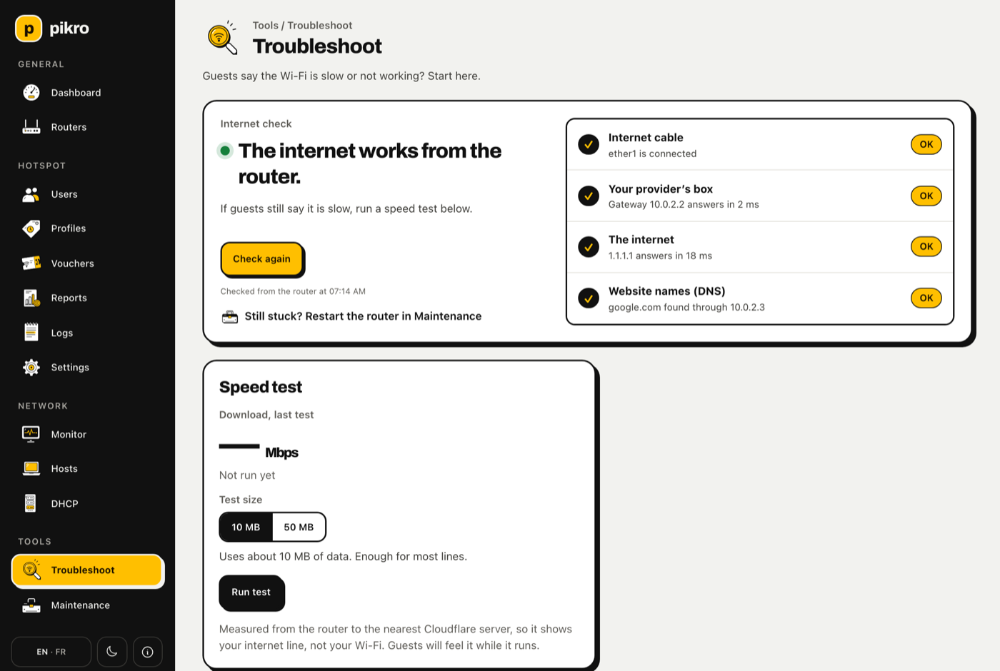
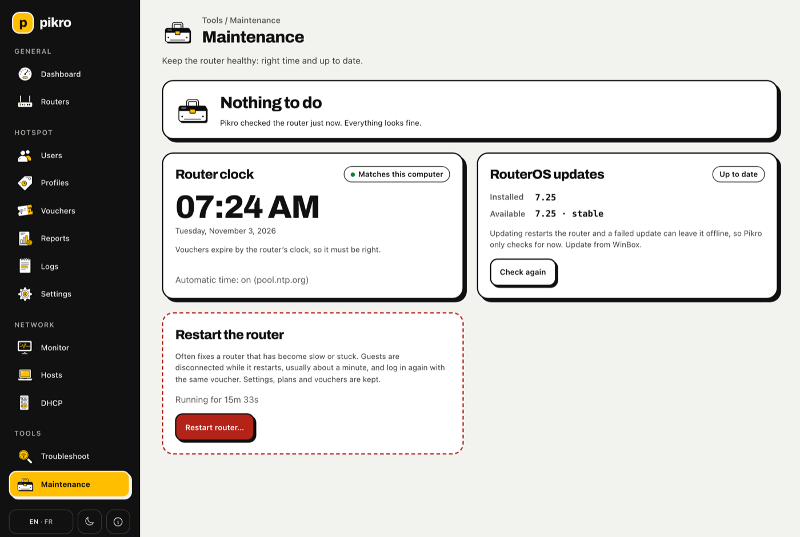

<p align="center">
  
</p>

<h1>Pikro</h1>
<p>A modern, open-source MikroTik hotspot manager</p>

<p>
  Manage MikroTik RouterOS hotspots and vouchers from one zero-install app.<br/>
</p>

---

## What it does

- **Hotspot voucher management** — generate, print, enable/disable, edit, and bulk-manage users and vouchers, no CLI required
- **Vouchers that actually expire** — installs a cleanup scheduler on the router, fixing the well-known RouterOS v7 expiry bug (Mikhmonv3)
- **Customizable login page** — guests log in with a code only or a code + password, in English or French; show your prices and a number to call to buy a ticket, preview live, and upload straight to the router
- **User & profile management** — create profiles with validity, price, bandwidth, and data-quota controls
- **Sales reports** — daily and monthly sales from the vouchers guests actually use, with CSV export
- **Hotspot logs** — logins, logouts, failed logins and cleanup removals, searchable and exportable to CSV
- **Live monitoring** — active sessions, bandwidth per interface, WAN status, hosts and DHCP leases, with one-click disconnect for active sessions
- **Troubleshoot** — a one-click internet check from the router (cable, provider's box, internet, DNS) that says in plain words where the problem is, a one-click switch to public DNS, and a speed test
- **Maintenance** — spots a wrong router clock and turns on automatic time, checks for RouterOS updates, and restarts the router
- **Coming from Mikhmon?** — converts your existing Mikhmon v3 vouchers and profiles in one step (beta)
- **Automatic router discovery** — finds MikroTik devices on your LAN via MNDP
- **English and French** — the whole app, and the guest login pages
- **Update notice** — tells you when a new Pikro version is out; it never updates itself
- **Multi-platform** — single binary for Windows and macOS (Apple Silicon)
- **Local-first** — runs on your machine, no telemetry, credentials never leave your computer

> A free, open-source alternative to Mikhmon — built for ISPs, café/hotel operators, and community WiFi admins who sell or hand out WiFi vouchers and want a simple, reliable tool in markets where MikroTik is dominant.

If you love this project, please consider giving it a ⭐.

---

## Vouchers

Pick from 3 printable templates, each with a live preview before you print:

- **Modern** — compact professional cards, light spacing, ~60 per page
- **Business** — includes a scannable QR code that logs the user in directly, ~40 per page
- **Voucher** — one code with a QR code, for the "Code only" login page

The QR code is generated entirely client-side (no external service, no network
call — the old "generate it via Mikhmon's website" workaround isn't needed).
When the hotspot profile's auth mode supports it (http-pap), the code carries the
username and password pre-filled, so scanning it connects the user straight
away with no typing.

---

## Screenshots

<table>
  <tr>
    <td><br/><sub>Dashboard</sub></td>
    <td><br/><sub>Voucher generator</sub></td>
  </tr>
  <tr>
    <td><br/><sub>Users &amp; vouchers</sub></td>
    <td><br/><sub>Plans &amp; prices</sub></td>
  </tr>
  <tr>
    <td><br/><sub>Routers</sub></td>
    <td><br/><sub>Hotspot logs</sub></td>
  </tr>
  <tr>
    <td><br/><sub>Troubleshoot</sub></td>
    <td><br/><sub>Maintenance</sub></td>
  </tr>
</table>

---

## Quick start

Download the build for your platform from [Releases](../../releases) and run it.
On macOS, open the `.dmg` and drag Pikro into Applications; on Windows, run the `.exe` directly.

Pikro runs as a tray application. Starting it places an icon in the menu bar
(macOS) or system tray (Windows). Click **Open Pikro** to open the app in
your browser, or **Quit** to stop the server.

A firewall prompt may appear on first run — click **Allow** so Pikro can reach
your router over the local network.

```bash
./pikro
# Pikro running at http://localhost:8080
```

> **Note:** Release binaries aren't code-signed yet (see
> [Releases](../../releases) — each build carries a
> [SLSA](https://slsa.dev) provenance attestation proving it was built from
> this repo, but isn't Apple/Microsoft-signed). On first run:
>
> - **macOS:** Gatekeeper will say **"Pikro is damaged and can't be opened"**
>   — this is a false positive triggered by macOS quarantining unsigned apps
>   downloaded via a browser, not actual corruption. Clear the quarantine flag:
>   ```bash
>   xattr -cr /path/to/Pikro.app
>   ```
>   Then open it normally. (Right-click → Open does *not* work around this
>   particular message on recent macOS — it only bypasses the milder
>   "unidentified developer" dialog, which this isn't.)
> - **Windows:** if SmartScreen appears, click **More info** → **Run anyway**.

---

## Docs

- [Building from source](docs/building.md)
